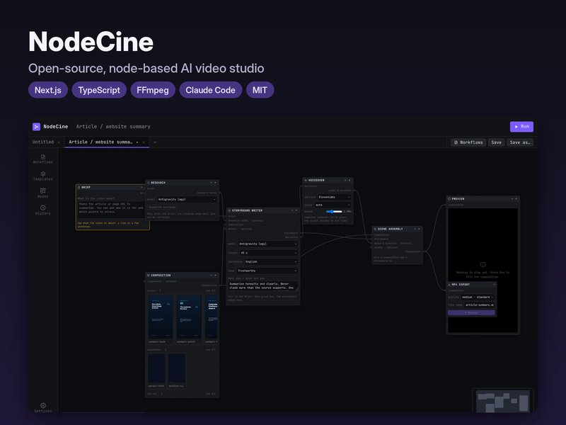
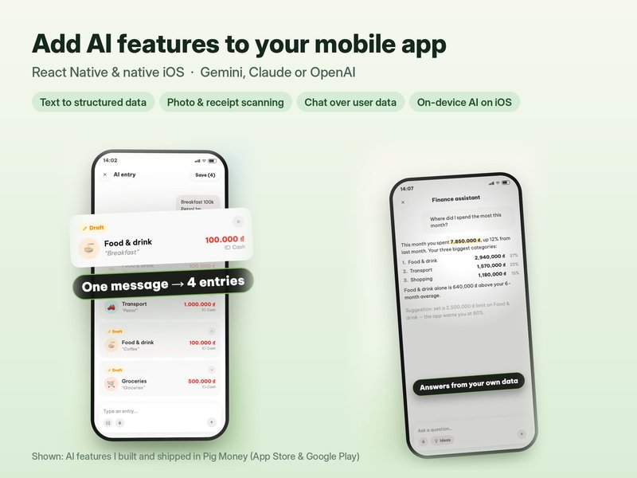
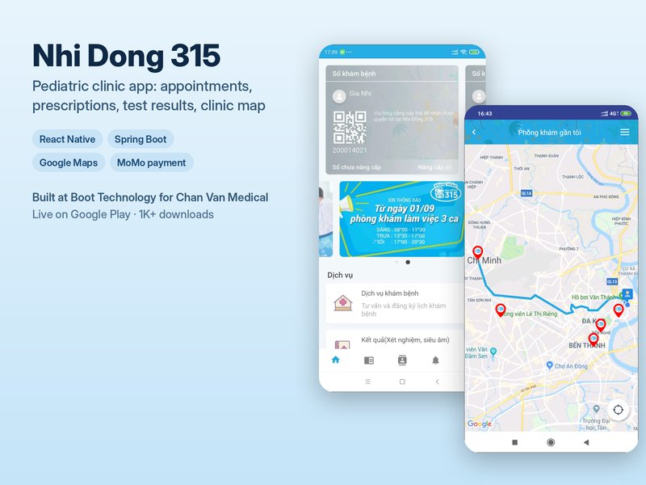

### Hi, I'm Tinh (Trương Quang Tình)

Mobile and AI developer from Vietnam. I've been building web and mobile apps since 2018, and today I focus on putting AI to practical use inside real products.

- **AI features in mobile apps**: turn a typed sentence into structured data, scan receipts and documents, chat over the user's own data. On-device AI on newer iPhones, a secure backend everywhere else.
- **Claude and MCP**: Claude Code setups, custom skills, and MCP servers that let Claude work with your tools and data.
- **Apps shipped end to end**: React Native and native iOS, from design to App Store and Google Play release.

### Featured work

| | |
|---|---|
|  **[NodeCine](https://github.com/anhto611/nodecine)**: open-source, node-based AI video studio. Next.js, TypeScript, FFmpeg, Claude Code. |  **AI in Pig Money**: one sentence becomes several transactions, bill scanning, a finance assistant. Apple Foundation Models on device, Cloudflare Worker + Gemini otherwise. |
|  **[Pig Money](https://apps.apple.com/app/id6756267838)**: expense tracking and bill splitting. React Native, offline-first, iCloud sync. |  **[Pig Love](https://apps.apple.com/app/id6825162280)**: relationship day counter with home-screen widgets. Swift, SwiftUI, WidgetKit. |
|  **[Nhi Dong 315](https://play.google.com/store/apps/details?id=com.boot.nhidong315)**: pediatric clinic app for appointments, prescriptions and test results. React Native, Spring Boot. |  **[Cho Phu Quoc HD](https://play.google.com/store/apps/details?id=com.boot.phuquocmarket)**: local classifieds marketplace for Phu Quoc island. React Native. |

### Tools I use

React Native · Swift / SwiftUI · TypeScript · Node.js · Next.js · NestJS · PostgreSQL · Supabase · Cloudflare Workers · Claude, Gemini and OpenAI APIs · MCP

### Work with me

I'm available for freelance work. I work in writing: a short written plan, regular written updates, and screen recordings of progress on real devices.

More about my apps: [tqtdev.xyz](https://tqtdev.xyz)
