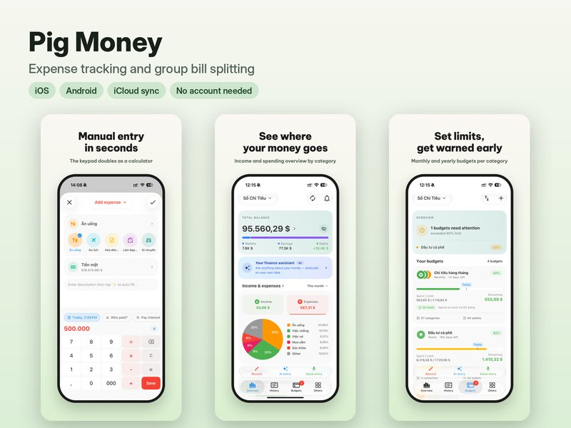
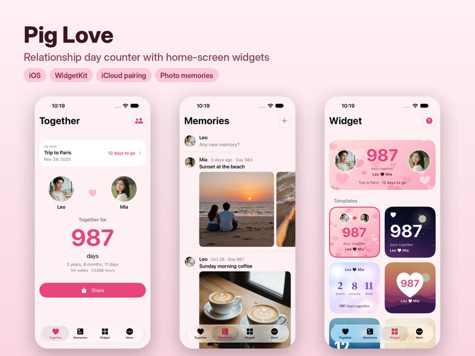
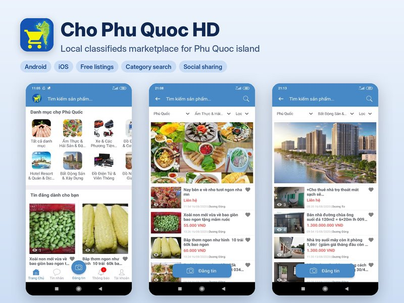

### Hi, I'm Tinh (Trương Quang Tình)

Mobile and AI developer from Vietnam. I've been building web and mobile apps since 2018, and today I focus on putting AI to practical use inside real products.

- **AI features in mobile apps**: turn a typed sentence into structured data, scan receipts and documents, chat over the user's own data. On-device AI on newer iPhones, a secure backend everywhere else.
- **Claude and MCP**: Claude Code setups, custom skills, and MCP servers that let Claude work with your tools and data.
- **Apps shipped end to end**: React Native and native iOS, from design to App Store and Google Play release.

### Featured work

<table>
<tr><td width="50%" valign="top"> <b><a href="https://github.com/anhto611/nodecine">NodeCine</a></b>: open-source, node-based AI video studio. Next.js, TypeScript, FFmpeg, Claude Code.</td><td width="50%" valign="top"> <b><a href="https://tqtdev.xyz">AI in Pig Money</a></b>: one sentence becomes several transactions, bill scanning, a finance assistant. Apple Foundation Models on device, Cloudflare Worker + Gemini otherwise.</td></tr>
<tr><td width="50%" valign="top"> <b><a href="https://apps.apple.com/app/id6756267838">Pig Money</a></b>: expense tracking and bill splitting. React Native, offline-first, iCloud sync.</td><td width="50%" valign="top"> <b><a href="https://apps.apple.com/app/id6825162280">Pig Love</a></b>: relationship day counter with home-screen widgets. Swift, SwiftUI, WidgetKit.</td></tr>
<tr><td width="50%" valign="top"> <b><a href="https://play.google.com/store/apps/details?id=com.boot.nhidong315">Nhi Dong 315</a></b>: pediatric clinic app for appointments, prescriptions and test results. React Native, Spring Boot.</td><td width="50%" valign="top"> <b><a href="https://play.google.com/store/apps/details?id=com.boot.phuquocmarket">Cho Phu Quoc HD</a></b>: local classifieds marketplace for Phu Quoc island. React Native.</td></tr>
</table>

### Tools I use

React Native · Swift / SwiftUI · TypeScript · Node.js · Next.js · NestJS · PostgreSQL · Supabase · Cloudflare Workers · Claude, Gemini and OpenAI APIs · MCP

### Work with me

I'm available for freelance work. I work in writing: a short written plan, regular written updates, and screen recordings of progress on real devices.

More about my apps: [tqtdev.xyz](https://tqtdev.xyz)
